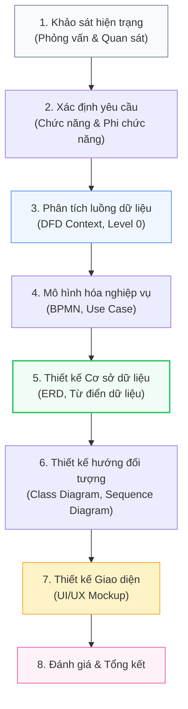

# ☕ ViePOS - Hệ thống Quản lý Hoạt động Kinh doanh F&B

> **Giải pháp quản lý bán hàng và kho nguyên liệu tối ưu cho mô hình F&B vừa và nhỏ**

---

## 📌 Giới thiệu

**ViePOS** là hệ thống quản lý tích hợp được thiết kế chuyên biệt cho các quán cà phê và cơ sở F&B quy mô vừa và nhỏ. Dự án tập trung giải quyết các thách thức trong vận hành như: sai sót khi quản lý thủ công, thất thoát nguyên vật liệu và áp lực tuân thủ quy định về hóa đơn điện tử. 

Với triết lý **"Vừa - Đủ - Tinh gọn"**, ViePOS cung cấp quy trình số hóa từ khâu Order đến quản lý kho đa tầng theo định mức (**BOM**).

> 📚 **Đồ án môn học:** Phân tích & Thiết kế Hệ thống Thông tin — Mã lớp: `252BIM5022`

---

## 👥 Nhóm thực hiện

| STT | Tên thành viên |
| :---: | :--- |
| **1** | Ma Thị Thu Hà |
| **2** | Nguyễn Như Huyền |
| **3** | Vũ Minh Nhật |
| **4** | Nguyễn Linh Yến Nhi |
| **5** | Trần Quang Vũ |

---

## 🎯 Mục tiêu

- **Số hóa quy trình bán hàng (POS):** Tiếp nhận Order, thanh toán và chuyển lệnh pha chế theo thời gian thực.
- **Quản lý kho chuyên sâu:** Theo dõi vòng đời nguyên vật liệu từ kho thô đến bán thành phẩm.
- **Tối ưu định mức (BOM):** Tự động trừ kho dựa trên công thức chế biến (*Hybrid BOM*) để kiểm soát hao hụt.
- **Hỗ trợ quản trị:** Cung cấp báo cáo doanh thu, tồn kho và cảnh báo ngưỡng an toàn/hạn sử dụng.

---

## 📁 Cấu trúc dự án

```text
ViePOS-system/
│
├── report/
│   └── ViePOS_system.pdf   # Báo cáo đồ án
│
└── README.md
```

---

## 🔄 Pipeline phát triển



---

## 🛠 Công nghệ & Công cụ sử dụng

- **Mô hình hóa:** Draw.io
- **Thiết kế UI/UX:** Figma
- **Quản lý dự án:** Google Sheets, Zalo, Google Meet, Google Docs
- **Kiến trúc hệ thống:** Web Application (Mô hình MVC)

---

## 🧪 Kết quả đạt được

- **Hệ thống POS linh hoạt:** Cho phép tùy chỉnh topping, ghi chú và in hóa đơn nhanh chóng.
- **Quản lý kho kép:** Xử lý tốt bài toán chuyển đổi từ nguyên liệu thô sang bán thành phẩm (sơ chế).
- **Tính minh bạch cao:** Lưu vết toàn bộ lịch sử xuất - nhập - tồn thông qua phiếu kiểm kê và giải trình chênh lệch.
- **Khả năng mở rộng:** Định hướng tích hợp thanh toán số (MoMo, VNPay) và kết nối các sàn Food Delivery (GrabFood, ShopeeFood).

---

## 💡 Hướng phát triển tương lai

- **Ứng dụng AI:** Dự đoán nhu cầu nguyên vật liệu để hạn chế lãng phí.
- **Quản trị đa chi nhánh:** Phát triển phân hệ kho tổng và điều phối hàng hóa giữa các điểm bán.
- **Omnichannel:** Đồng bộ doanh thu từ các nền tảng đặt món trực tuyến qua API.

---

<div align="center">
  <sub>Đồ án môn học Phân tích & Thiết kế Hệ thống Thông tin • ViePOS Team © 2026</sub>
</div>